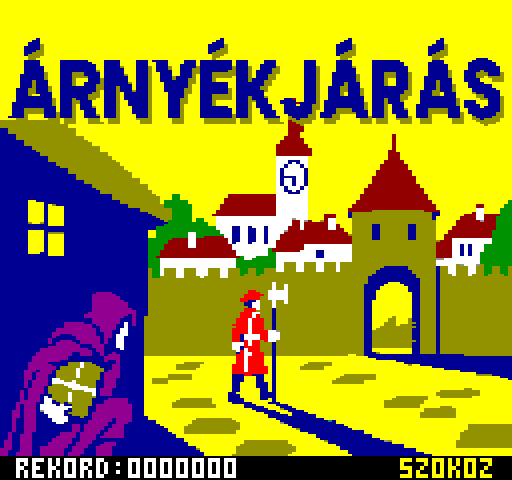
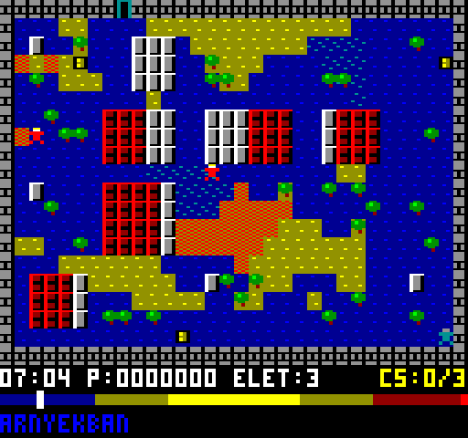
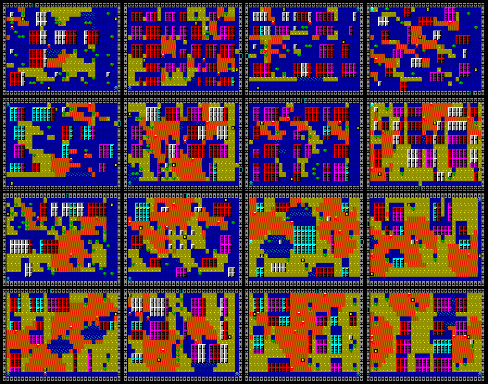

# ÁRNYÉKJÁRÁS – Videoton TVC 64K (v09)

Saját játék, nem átirat. Lopakodás egy városban, ahol csak az árnyék véd: a nap keletről nyugatra halad, és az épületek, fák és a városfal árnyéka folyamatosan fordul és változik a hossza. Pályánként 3 csomagot kell kapuzárás (18:00) előtt kicsempészni. Az őrök csak a napon látnak meg. 16 pálya, fokozatosan nehezedve.

16 színű mód (128×240), Z80 gépi kód, `10 PRINT USR(6659)` BASIC betöltővel, automatikus indítással. Kész fájl: `dist/arnyek.cas`.





## Irányítás

| Billentyű | Funkció |
|---|---|
| Kurzorok / joystick | lépés (nyomva tartva ismétel) |
| Szóköz / Tűz | indítás, továbblépés; játék közben nyomva tartva várakozás (8× gyorsabb idő) |
| Esc | kilépés a BASIC-be – rákérdez: még egy Esc = kilépés, bármely más billentyű = folytatás |

## Játékszabályok

- Napos mező (sárga) egy őr látókörében (5 cella, takarás figyelembevételével): lebukás. A belátott napos mezőket narancs-piros kockázás jelzi.
- Árnyékban (sötétkék, kék pöttyökkel) és felhő alatt (sötétkék, türkiz pöttyökkel) nem látnak, de a közvetlenül melletted elhaladó őr így is észrevesz.
- A kapu csak mind a 3 csomaggal nyílik (ilyenkor világoskék lesz).
- 18:00-kor bezárják a kaput.

## Pályák



| # | Pálya | Indulás | Őr | Felhő | Leggyorsabb kijutás | Tűrés | Figyelt terület | Nehézség |
|---|---|---|---|---|---|---|---|---|
| 1 | Kertváros | 7:00 | 2 | 2 | 7:36 | 20 | 13% | 16.7 |
| 2 | Sikátorok | 10:00 | 4 | 1 | 10:23 | 20 | 15% | 21.8 |
| 3 | Halpiac | 7:00 | 3 | 2 | 7:30 | 20 | 19% | 23.9 |
| 4 | Déli kapu | 7:00 | 3 | 1 | 7:25 | 20 | 22% | 26.5 |
| 5 | Rakpart | 7:00 | 3 | 1 | 7:35 | 20 | 24% | 28.6 |
| 6 | Malomsor | 9:00 | 4 | 2 | 9:36 | 20 | 26% | 32.4 |
| 7 | Céhházak | 8:00 | 3 | 2 | 14:06 | 20 | 21% | 33.8 |
| 8 | Kaszárnya | 13:00 | 5 | 1 | 16:27 | 20 | 19% | 37.2 |
| 9 | Temetőkert | 8:00 | 3 | 1 | 14:23 | 20 | 28% | 41.1 |
| 10 | Piactér | 8:00 | 4 | 2 | 8:51 | 12 | 30% | 43.9 |
| 11 | Várudvar | 12:00 | 4 | 3 | 16:17 | 20 | 30% | 45.5 |
| 12 | Főtér | 10:00 | 4 | 2 | 10:44 | 12 | 34% | 47.7 |
| 13 | Városháza | 12:00 | 5 | 2 | 16:13 | 20 | 34% | 51.0 |
| 14 | Vámház | 9:00 | 4 | 1 | 17:32 | 12 | 28% | 55.0 |
| 15 | Kincstár | 12:00 | 6 | 1 | 17:10 | 12 | 34% | 63.3 |
| 16 | Kolostor | 11:00 | 5 | 2 | 17:56 | 8 | 34% | 71.9 |

- **Leggyorsabb kijutás:** a megoldó szerint, hibátlan játékkal.
- **Tűrés:** a leglassabb lépéstempó (5, 8, 12 vagy 20 képkocka lépésenként), amellyel a pálya még teljesíthető. A játék ismétlési tempója 5 képkocka, tehát a 20 negyed sebességet jelent, a 8 pedig azt, hogy csak gyors és pontos játékkal lehet kijutni.
- **Figyelt terület:** a járható mezők hány százalékát látják átlagosan az őrök a nap során.
- **Nehézség:** a fentiekből számolt összesített érték (`design.py` `difficulty()`), főleg a tűrés, a figyelt terület, az őrök száma és a szükséges várakozás alapján. A pályák ennek emelkedő sorrendjében követik egymást.

A 13 új pálya félautomatikusan készült. Témánként megadtam a stílust (kertváros, sikátor, nyitott terek, vár), az indulási időt, az őrök és a felhők számát, és azt, hogy az őrök mennyire őrizzék a csomagokat és a kaput. A `gen_levels.py` ebből utcahálós várost generál, a megoldó minden jelöltet lemér, és a `design_select.py` témánként azt választja, amellyel a 16 pálya nehézsége a legegyenletesebben emelkedik.

## Megoldhatóság

A `solver.py` a játék pontos időzítésével (játékperc 12, őrlépés 22, lépés 5 képkocka, várakozás 8×) és a demóval azonos árnyék- és látómező-számítással keresi a leggyorsabb győztes utat:

| Pálya | Indulás | Leggyorsabb kijutás | Lépés | Várakozás |
|---|---|---|---|---|
| Déli kapu | 7:00 | 7:25 | 59 | 2 |
| Piactér | 8:00 | 8:51 | 75 | 30 |
| Várudvar | 12:00 | 16:17 | 74 | 340 (kb. 7 mp valós idő) |

A `test_replay.py` a megoldó útját billentyűleütésekké alakítja, és a kész CAS-on végigjátssza a tvcsim-ben: mind a 16 pályán kijut, és a TVC pontszáma pályánként egyezik a modellével.

## Pontozás és életek

Pálya végén: **(csomagok × 100 + a kapuzárásig hátralévő játékpercek × 5 + árnyékbónusz) × a pálya sorszáma**.

- Az árnyékbónusz 300 pont, ami minden napos mezőre tett lépéssel 10 ponttal csökken (legfeljebb 0-ig). Egy lépés akkor napos, ha a lépés pillanatában napos mezőre visz. Egy napos lépés 2 játékperc időbónuszt ér, ezért a gyorsaság és az árnyékban maradás valódi döntés.
- 3 élet. Lebukáskor vagy kapuzáráskor elvész egy, és a pálya újrakezdődik. A pontok csak a sikeres pályák után járnak, így a megszerzett pontok megmaradnak.
- Ha elfogynak az életek: JATEK VEGE; ha az utolsó pálya is kész: GRATULALOK; új rekordnál mindkét esetben UJ REKORD. Szóközre vissza a címképre, ahol a rekord is látszik. A rekord a munkamenetre szól, mint a BLOKK 3D-ben.
- A pontszám, a rekord és a pályánkénti pont 24 bites (legfeljebb 16 777 215), így a pályaszorzóval kb. 88 pályáig akkor sem telik be, ha minden pályán az elméleti maximumot (4200 alappont) éred el.
- Kijelző: `07:00 P:0000000 ELET:3 CS:0/3`. Az utolsó élet piros, pálya végén az állapotsorban az összesítő látszik (`KIJUTOTTAL! +06100`).

A `python3 solver.py --pont` pályánként kiszámolja a legjobb elérhető pontszámot is (lassú: nehéz pályánként több perc).

## Címkép

A játék a címképpel indul (alul a munkamenet rekordja és SZOKOZ), szóközre jön az 1. pálya.

- A kép ChatGPT-vel készült a `docs/betoltokep-prompt.md` promptjával, két változatban: `docs/betoltokep_a.png` (sík színek, ez van a játékban) és `docs/betoltokep_b.png` (raszterrel).
- `conv_title.py`: a képet 4:3-ra vágja, 128×240-re kicsinyíti úgy, hogy célképpontonként a leggyakoribb TVC-szín marad (nincs színkeverés), a felső sávba ráírja az ÁRNYÉKJÁRÁS címet (sötétkék betűk, sötétsárga árnyékkal), kézzel javítja a toronyórát (128 képpont szélesen vigyorgó arcnak látszott), és RLE-vel tömöríti: 15 360 bájtról 7554 bájtra.
- A program `unrle` rutinja közvetlenül a képernyőmemóriába bontja ki.
- A másik változatra váltás: a `build.sh`-ban `betoltokep_a.png` helyett `betoltokep_b.png` (8370 bájt tömörítve).

## Képernyő

- A pálya 32×20 cella, cellánként 4×10 képpont (2 bájt × 10 sor), ez nagyjából négyzetes a TVC széles képpontjaival.
- Alatta 40 sor: óra (17:00-tól piros), pontszám, életek, csomagszámláló, napszak-sáv a nappal és a kapuzárás jelével, valamint állapotsor (NAPON / ARNYEKBAN / FELHO ALATT / VARAKOZAS, illetve üzenetek).
- Cellás frissítés: a program kiszámolja, minek kellene a képernyőn lennie (`DESIRED`), és csak azokat a cellákat rajzolja újra, amelyek eltérnek a kirajzolttól (`SHOWN`).
- Bitkiosztás 16 színű módban: a bal képpont a páratlan bitekben (b7=I, b5=G, b3=R, b1=B), a jobb a párosakban. Ez az ep128emu `tvcvideo.cpp` alapján készült, amelyre az Ep128web is épül.
- Színek az ep128emu szerint: a nem világos színek 4/7 fényerejűek, a 8-as szín (csak I) fekete. Ezért a városfal szürke (7) fekete fugákkal; a v06-ig 8-as színnel rajzolt fal az emulátorban feketén beleolvadt volna a háttérbe.

## Hang

Egycsatornás TVC hanggenerátor, a BLOKK 3D hangrendszerével: képkockánként léptetett effektek prioritással, a `gen_game.py` `SFX` táblájában Hz-ben állíthatók.

| Esemény | Effekt |
|---|---|
| lépés | halk koppanás (300 Hz) |
| várakozás | ketyegés játékpercenként |
| egész óra | harangszó (880 Hz, lecsengő) |
| 17:00 | dupla, mélyebb harang |
| 18:00 | háromszori mély harangozás, kapuzárás |
| csomag | felfutó dallam |
| mind a 3 csomag | csilingelés, nyílik a kapu |
| zárt kapu | mély zümmögés |
| lebukás | lefelé lépő dallam |
| kijutás | fanfár |
| pályaindítás | rövid szignál |

A hosszú számítások (árnyékvetés soronként, képfrissítés soronként, látómező őrönként) közben a `snd_poll` lépteti a hangot, így az nem nyúlik meg. Az így elnyelt képkockákat a `vsync` számon tartja, ezért a játékidő ütemét ez nem lassítja.

## Árnyék és látómező

- `shadow.asm`: táblavezérelt vetés. Napállásonként (10 játékperc) egy irány-offsetlista tartozik, és magasságonként egy darabszám. A 64 bájt széles, margós puffer miatt nincs vágás. Legrosszabb eset kb. 305 000 ciklus (kb. 98 ms), 10 játékpercenként.
- `vision.asm`: az őrök látómezeje, előre kiszámolt Bresenham-utakkal. A látott cellák 3-as értékkel ugyanabba az árnyékpufferbe kerülnek, így a törlés is olcsó. Őrönként átlagosan kb. 38 000 ciklus.
- A felhők 8.8 fixpontosan vonulnak, és csak akkor kérnek új árnyékot, amikor egész cellát léptek.

## Pályaformátum

Egy pálya 147–372 bájt (a sűrűn beépített sikátoros pályák a legnagyobbak), a 16 pálya összesen 3512 bájt. A pályakezdéskor a `build_map` felépíti belőle az árnyékosztály-térképet (`CLASSBUF`) és a csempe-alapot (`BASEBUF`):

```
dw  név
db  kezdő x, y, kapu x, y, napállás (0 = 6:00, 10 percenként)
db  épületek száma, majd (x, y, szélesség, magasság, árnyékosztály)*
db  fák száma, majd (x, y)*
db  csomagok száma, majd (x, y)*
db  felhők száma, majd (dw alak, db y, dw x 8.8)*     ; az alakok közösek
db  őrök száma, majd (körbejár?, pontok száma, (x, y)*)*
```

A program a címképpel együtt 19,1 KB, a `$8000` alatt 6552 bájtot hagy szabadon. Ebbe még kb. 20–40 pálya fér (a mérettől függően).

Minden pálya egy helyen van: `levels.py` (a lista sorrendje a játék sorrendje, a sorszámot a generátor írja a név elé). Új pálya felvétele vagy módosítása után:

```
python3 design.py 17 -m    # ellenőrzés, ASCII-térkép, nehézség (itt a 17. pályára)
./build.sh
python3 test_game.py && python3 test_quit.py && python3 test_replay.py
python3 gen_demo.py ../arnyekjaras.html    # a böngészős demó pályái
```

## Memória (lapozás `$90` = U0 | U1 | VID | U3, mint a BLOKK 3D-ben)

- `$19EF–` BASIC betöltő, kód, táblák, tömörített címkép (19,1 KB, `IMAGE_END` < `$8000`)
- `$8000–$BBFF` képernyő
- `$C000` árnyékpuffer (64×38), `$CA00` takarási térkép, `$D400` csempe-alap, `$D700` kívánt csempék, `$DA00` kirajzolt csempék, `$DD00` változók, `$E000` árnyékosztály-térkép, verem az U3 tetején

## Fordítás

```
./build.sh        # gen_tables.py + gen_game.py + conv_title.py -> arnyek.asm (sjasmplus) -> arnyek.cas
```

Kell hozzá Python 3 és sjasmplus (`SJASMPLUS=/út/sjasmplus ./build.sh`). A CAS-csomagoló (`mkcas.py`) a BLOKK 3D-é, változatlanul.

## Tesztek

```
gcc -O2 -I<z80-mappa> -o harness/tvcsim harness/tvcsim.c <z80-mappa>/z80.c
python3 test_shadow.py   # táblás árnyékalgoritmus a demóhoz mérve: 6912 eset
python3 test_asm.py      # shadow.asm + vision.asm a z80sim-ben: 5292 eset, ciklusszámok
                         # (az első 3 pályán minden napállás, a többin minden 6.)
python3 test_game.py     # a kész CAS a tvcsim-ben: árnyék/látómező 31 időpontban,
                         # mozgás, lebukás, kapuzárás, győzelem, pályaváltások,
                         # a felépített térképek mind a 16 pályán,
                         # életek, játék vége, rekord, új játék,
                         # a kibontott címkép bájtra egyezik a konverterével
python3 test_sound.py    # SNDLOG alapján: mind a 11 effekt a várt eseménynél szól
python3 solver.py        # leggyorsabb győztes út pályánként és annak pontszáma
python3 solver.py --pont # + a legjobb elérhető pontszám (lassú, kb. 4 perc)
python3 test_replay.py   # a megoldó útja a kész CAS-on: mind a 16 pályán kijut,
                         # és a TVC pontszáma egyezik a modellével
```

A tesztek a koordinátákat a pályaadatokból számolják (`testlv.py`), így bármilyen pályasorrendre érvényesek. A címképről a tesztkörnyezet automatikusan továbblép (`skip_title`), és minden eseményt ennyivel később futtat.

A `harness/tvcsim.c` a BLOKK 3D tesztkörnyezete három kiegészítéssel:
- 16 színű képmentés, az ep128emu színeivel;
- `HOOK=cím`: a kiolvasás és a képmentés a főciklus nyugalmi pontján (a `vsync`-ben) történik, nem félkész újraszámolás közben;
- `ITER=1` (a `HOOK` mellett): minden esemény a főciklus köreihez kötve. A játék ideje is körönként halad, így a megoldó útja pontosan visszajátszható.

## Fájlok

- `arnyek.asm` – főprogram: indítás és kilépés, főciklus, játéklogika, képfrissítés, kijelző, font
- `shadow.asm`, `vision.asm` – árnyék- és látómező-modul
- `levels.py` – a 16 pálya
- `gen_tables.py` – napállás-táblák, látómező-utak; a `level*.inc` (kész osztálytérképek) csak a modultesztekhez kell
- `gen_game.py` – csempék (32 × 20 bájt), 3×5-ös font, napszak-sáv, hangeffektek, közös felhőalakok, tömör pályaleírók
- `z80sim.py` – kis Z80 asm-értelmező a modultesztekhez
- `solver.py` – megoldó: leggyorsabb út, tűrés, legjobb pontszám
- `design.py` – pályaellenőrzés, ASCII-térkép, nehézségi mérőszámok
- `gen_levels.py`, `design_search.py`, `design_select.py` – pályajelöltek generálása, mérése és kiválasztása
- `gen_demo.py` – a böngészős demó pályáinak frissítése
- `conv_title.py` – a címkép átalakítása (TVC-paletta, 128×240, cím, RLE)
- `testlv.py` – pályafüggetlen segédek a tesztekhez
- `docs/betoltokep-prompt.md` – prompt a betöltőképhez (ChatGPT), a TVC palettájával

## Ismert korlátok

- Csak a tvcsim-ben tesztelve, valódi gépen és Ep128web-ben még nem.
- A szövegek ékezet nélküliek (3×5-ös font).
- A nehézségi érték becslés: a megoldó hibátlan játékot feltételez, emberi játékosnál a sorrend kicsit eltérhet.
- Az utolsó pálya (Kolostor) hibátlan játékkal is csak 17:56-ra teljesíthető.

## Változások

- v08: címkép (ChatGPT-vel készült, `conv_title.py` alakítja át, RLE-vel tömörítve), rajta a munkamenet rekordja; játék vége után a címképre tér vissza.
- v09: az Esc nem lép ki azonnal: az állapotsorban rákérdez (közben áll az idő), egy véletlen Esc nem szakítja meg a játékot. Kilépéskor a játék törli a képernyőt, így a BASIC nem a megállt játékkép alatt fut tovább (ez nézett ki kifagyásnak). `test_quit.py`; a tvcsim `WATCHDOG=N` kapcsolója kifagyást és veremszivárgást figyel.
- v07: 16 pálya, fokozatosan nehezedve (13 új, a régi hármat a nehézségük szerint besorolva); legfeljebb 6 őr pályánként. A pályák egy helyen, a `levels.py`-ban. Új eszközök: nehézségmérés, pályagenerátor, kiválasztás. Javítva: a városfal 8-as színnel (az emulátorban fekete) volt rajzolva, most szürke; a tesztkörnyezet színei az ep128emu-hoz igazítva. A tesztek pályafüggetlenek, a végigjátszás mind a 16 pályán fut. Betöltőkép-prompt a `docs/` mappában.
- v06: 24 bites pontszám, rekord és pályapont, 7 számjegy (`P:0000000`); végigjátszás után GRATULALOK. A teszt a 65 535 fölötti összeadást és rekordot is ellenőrzi.
- v05: pontozás (csomag, időbónusz, fokozatos árnyékbónusz, pályaszorzó), 3 élet, játék vége, munkamenet-rekord; „+” a fontban. Javítva: kapuzáráskor 18:09-et mutatott az óra; a napszak-sáv jele csonkokat hagyott.
- v04: tömör pályaformátum (épületlista, közös felhőalakok, futásidejű térképépítés); a program 11,8 KB-ról 8,3 KB-ra csökkent, pályánként kb. 150 bájt. A teszt a felépített térképeket is bájtra ellenőrzi.
- v03: 3. pálya (Várudvar), 3 felhő. Javítva: a függőlegesen járőröző őrök a v01 óta egy helyben billegtek x-ben, ahelyett hogy fel-le jártak volna. Új: megoldó és végigjátszó teszt; a játékteszt az őrök helyét is ellenőrzi.
- v02: hang.
- v01: első változat, két pálya.
