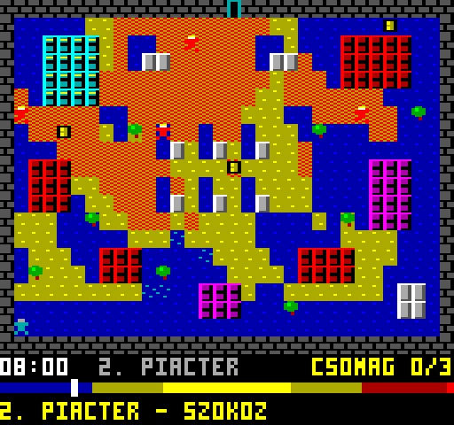

# ÁRNYÉKJÁRÁS – Videoton TVC 64K (v02)

Saját játék, nem átirat. Lopakodás egy városban, ahol csak az árnyék véd: a nap keletről nyugatra halad, és az épületek, fák és a városfal árnyéka folyamatosan fordul és változik a hossza. A 3 csomagot kapuzárás (18:00) előtt kell kicsempészni. Az őrök csak a napon látnak meg.

16 színű mód (128×240), Z80 gépi kód, `10 PRINT USR(6659)` BASIC betöltővel, automatikus indítással. Kész fájl: `dist/arnyek.cas`.


## Irányítás

| Billentyű | Funkció |
|---|---|
| Kurzorok / joystick | lépés (nyomva tartva ismétel) |
| Szóköz / Tűz | indítás, továbblépés; játék közben nyomva tartva várakozás (8× gyorsabb idő) |
| Esc | kilépés a BASIC-be |

## Játékszabályok

- Napos mező (sárga) egy őr látókörében (5 cella, takarás figyelembevételével): lebukás. A belátott napos mezőket narancs-piros kockázás jelzi.
- Árnyékban (sötétkék, kék pöttyökkel) és felhő alatt (sötétkék, türkiz pöttyökkel) nem látnak, de a közvetlenül melletted elhaladó őr így is észrevesz.
- A kapu csak mind a 3 csomaggal nyílik (ilyenkor világoskék lesz).
- 18:00-kor bezárják a kaput.
- Két pálya: Déli kapu (7:00-tól, 3 őr, 1 felhő) és Piactér (8:00-tól, 4 őr, ebből egy körbejár, 2 felhő, négy szint magas templomtorony).



## Képernyő

- A pálya 32×20 cella, cellánként 4×10 képpont (2 bájt × 10 sor), ez nagyjából négyzetes a TVC széles képpontjaival.
- Alatta 40 sor: óra (17:00-tól piros), pályanév, csomagszámláló, napszak-sáv a nappal és a kapuzárás jelével, valamint állapotsor (NAPON / ARNYEKBAN / FELHO ALATT / VARAKOZAS, illetve üzenetek).
- Cellás frissítés: a program kiszámolja, minek kellene a képernyőn lennie (`DESIRED`), és csak azokat a cellákat rajzolja újra, amelyek eltérnek a kirajzolttól (`SHOWN`).
- Bitkiosztás 16 színű módban: a bal képpont a páratlan bitekben (b7=I, b5=G, b3=R, b1=B), a jobb a párosakban. Ez az ep128emu `tvcvideo.cpp` alapján készült, amelyre az Ep128web is épül.

## Hang

Egycsatornás TVC hanggenerátor, a BLOKK 3D hangrendszerével: képkockánként léptetett effektek prioritással, a `gen_game.py` `SFX` táblájában Hz-ben állíthatók.

| Esemény | Effekt |
|---|---|
| lépés | halk koppanás (300 Hz) |
| várakozás | ketyegés játékpercenként |
| egész óra | harangszó (880 Hz, lecsengő) |
| 17:00 | dupla, mélyebb harang |
| 18:00 | háromszori mély harangozás, kapuzárás |
| csomag | felfutó dallam |
| mind a 3 csomag | csilingelés, nyílik a kapu |
| zárt kapu | mély zümmögés |
| lebukás | lefelé lépő dallam |
| kijutás | fanfár |
| pályaindítás | rövid szignál |

A hosszú számítások (árnyékvetés soronként, képfrissítés soronként, látómező őrönként) közben a `snd_poll` lépteti a hangot, így az nem nyúlik meg. Az így elnyelt képkockákat a `vsync` számon tartja, ezért a játékidő ütemét ez nem lassítja.

## Árnyék és látómező

- `shadow.asm`: táblavezérelt vetés. Napállásonként (10 játékperc) egy irány-offsetlista tartozik, és magasságonként egy darabszám. A 64 bájt széles, margós puffer miatt nincs vágás. Legrosszabb eset kb. 305 000 ciklus (kb. 98 ms), 10 játékpercenként.
- `vision.asm`: az őrök látómezeje, előre kiszámolt Bresenham-utakkal. A látott cellák 3-as értékkel ugyanabba az árnyékpufferbe kerülnek, így a törlés is olcsó. Őrönként átlagosan kb. 38 000 ciklus.
- A felhők 8.8 fixpontosan vonulnak, és csak akkor kérnek új árnyékot, amikor egész cellát léptek.

## Memória (lapozás `$90` = U0 | U1 | VID | U3, mint a BLOKK 3D-ben)

- `$19EF–` BASIC betöltő, kód, táblák (kb. 9,8 KB, `IMAGE_END` < `$8000`)
- `$8000–$BBFF` képernyő
- `$C000` árnyékpuffer (64×38), `$CA00` takarási térkép, `$D400` csempe-alap, `$D700` kívánt csempék, `$DA00` kirajzolt csempék, `$DD00` változók, verem az U3 tetején

## Fordítás

```
./build.sh        # gen_tables.py + gen_game.py -> arnyek.asm (sjasmplus) -> arnyek.cas
```

Kell hozzá Python 3 és sjasmplus (`SJASMPLUS=/út/sjasmplus ./build.sh`). A CAS-csomagoló (`mkcas.py`) a BLOKK 3D-é, változatlanul.

## Tesztek

```
gcc -O2 -I<z80-mappa> -o harness/tvcsim harness/tvcsim.c <z80-mappa>/z80.c
python3 test_shadow.py   # táblás árnyékalgoritmus a demóhoz mérve: 864 eset
python3 test_asm.py      # shadow.asm + vision.asm a z80sim-ben: 1344 eset, ciklusszámok
python3 test_game.py     # a kész CAS a tvcsim-ben: árnyék/látómező 31 időpontban,
                         # mozgás, lebukás, kapuzárás, győzelem + 2. pálya
python3 test_sound.py    # SNDLOG alapján: mind a 11 effekt a várt eseménynél szól
```

A `harness/tvcsim.c` a BLOKK 3D tesztkörnyezete két kiegészítéssel: 16 színű képmentés, valamint a `HOOK=cím` környezeti változó. Ezzel a kiolvasás és a képmentés a főciklus nyugalmi pontján (a `vsync`-ben) történik, nem félkész újraszámolás közben.

## Fájlok

- `arnyek.asm` – főprogram: indítás és kilépés, főciklus, játéklogika, képfrissítés, kijelző, font
- `shadow.asm`, `vision.asm` – árnyék- és látómező-modul
- `gen_tables.py` – napállás-táblák, látómező-utak, pályák osztálytérképe és felhőmaszkjai
- `gen_game.py` – csempék (32 × 20 bájt), 3×5-ös font, napszak-sáv, pályaleírók
- `z80sim.py` – kis Z80 asm-értelmező a modultesztekhez

## Ismert korlátok (v01)

- Csak a tvcsim-ben tesztelve, valódi gépen és Ep128web-ben még nem.
- A szövegek ékezet nélküliek (3×5-ös font).
- A Piactér nehéz; a pályák hangolása még hátravan.
